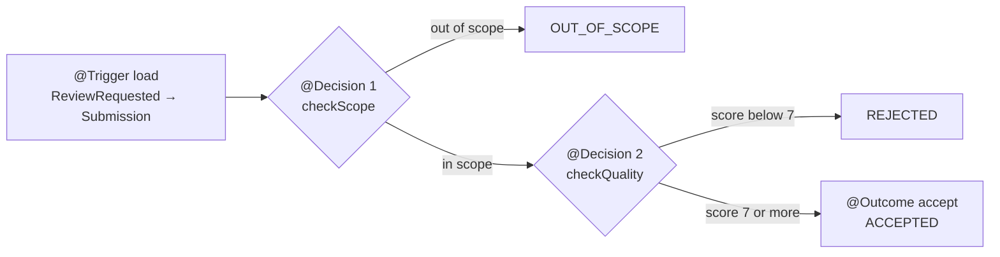

# JCON Brazil 2030 – Call for Papers

A small CFP (call for papers) app: speakers submit talk proposals on a web
page, and the proposals show up in a table.

> **JCON Brazil is a fictional event for a live-coding demo.**
> This project is the starting point for a live session in which we add an AI
> reviewer agent with Jakarta Agentic AI.

## Watch the live session

We fill this repository live on stream:
**[youtube.com/live/bm4BRjW0pUs](https://youtube.com/live/bm4BRjW0pUs)**

<a href="https://youtube.com/live/bm4BRjW0pUs">
  
</a>

## Run it

You only need Docker:

```bash
docker compose up --build
```

This starts two containers:

| Container | What it does |
|-----------|--------------|
| `payara`  | Builds the WAR with Maven and deploys it on the stock `payara/micro:7.2026.9` image |
| `ollama`  | Runs Ollama, pulls `gemma3:4b` on first start (several GB, cached in a volume) and loads it into memory |

The web app does not wait for the model. `docker compose ps` shows `ollama` as
*healthy* once `gemma3:4b` is downloaded, loaded and has answered a warm-up
prompt. Reviews requested before that are slow or fail with a timeout.

### With an NVIDIA GPU

On CPU one review takes about a minute. With an NVIDIA GPU it takes a few
seconds. You need the NVIDIA driver and the NVIDIA Container Toolkit (Docker
Desktop on Windows with WSL2 already has it). Add the GPU override file:

```bash
docker compose -f docker-compose.yml -f docker-compose.gpu.yml up --build
```

Check that the GPU is used:

```bash
docker compose exec ollama nvidia-smi   # lists your GPU
docker compose exec ollama ollama ps    # PROCESSOR column shows "100% GPU"
```

The very first start compiles CUDA kernels for your GPU, which takes a few
minutes. They are cached in the `ollama-models` volume, so later starts are fast.

## URLs

| URL | What |
|-----|------|
| http://localhost:8080/ | The CFP page |
| http://localhost:8080/api/submissions | All submissions as JSON |
| http://localhost:11434/api/tags | Models available in Ollama |

## API

| Method | Path | |
|--------|------|-|
| `GET`  | `/api/submissions` | List all submissions (3 are seeded) |
| `POST` | `/api/submissions` | Create a submission; returns 400 with the validation errors |
| `POST` | `/api/submissions/{id}/review` | Runs the reviewer agent and returns the submission with its `review`; 404 for an unknown id |

```bash
curl -X POST http://localhost:8080/api/submissions/1/review
```

```json
{ "id": 1, "talkTitle": "Virtual Threads in Production: What We Learned", "...": "...",
  "review": { "verdict": "ACCEPTED", "reason": "Score 8/10. Concrete example, ..." } }
```

`verdict` is one of `OUT_OF_SCOPE`, `REJECTED`, `ACCEPTED` or `FAILED` (the
model could not be reached or gave an unreadable answer).

## Stack

- Java 21, Maven, WAR
- Jakarta EE 11 Web Profile (JAX-RS, CDI, Bean Validation, JSON-B)
- [Jakarta Agentic AI](https://jakartaee.github.io/agentic-ai/) `jakarta.agentic-ai:jakarta.agentic-ai-api:1.0.0-M1` (provided)
- Payara Micro `7.2026.9` (bundles the Agentic AI implementation)
- Ollama with `gemma3:4b`
- Plain HTML, CSS and JavaScript. No frameworks, no database: everything is in memory.

## Project layout

```
src/main/java/com/jconbrazil/cfp/
  Submission.java            the record that is stored and returned
  NewSubmission.java         what the form sends, with validation
  Track / Level / Format     enums
  SubmissionStore.java       @ApplicationScoped in-memory store, 3 seeded talks
  SubmissionResource.java    REST endpoints under /api/submissions
  ValidationErrorMapper.java validation errors as JSON
  RestApplication.java       @ApplicationPath("/api")
  SubmissionReviewAgent.java the reviewer agent (Jakarta Agentic AI)
  ReviewRequested.java       CDI event that triggers the agent
  ScopeCheck / QualityCheck  what the model answers in the two decisions
  Review.java                the stored verdict and reason
  LlmJson.java               reads the JSON out of a model reply
src/main/resources/META-INF/microprofile-config.properties   LLM settings
src/main/webapp/             index.html, css/style.css, js/app.js, img/
samples/                     abstracts to paste during the stream
docker-compose.gpu.yml       optional NVIDIA GPU support for Ollama
```

The logo goes to `src/main/webapp/img/jcon-brazil-2030.png`. Without it the
page shows the text "JCON Brazil 2030" instead.

## LLM configuration

Payara reads the LLM settings with MicroProfile Config
(`src/main/resources/META-INF/microprofile-config.properties`):

```properties
payara.agentic.llm.provider=ollama
payara.agentic.llm.model=gemma3:4b
payara.agentic.llm.ollama.base-url=http://localhost:11434
```

In Docker Compose, the environment variable
`PAYARA_AGENTIC_LLM_OLLAMA_BASE_URL=http://ollama:11434` overrides the base URL.
The key names come from `LlmBackendFactory` in the Payara source
(`appserver/agentic-ai/agentic-ai-core`, tag `payara-server-7.2026.9`).

## The reviewer agent

`SubmissionReviewAgent` is a CDI bean annotated with `@Agent` from
[Jakarta Agentic AI](https://jakartaee.github.io/agentic-ai/). Each review is
one workflow:



1. `SubmissionResource.review(...)` fires the CDI event `ReviewRequested`.
   Payara runs the workflow synchronously inside `Event.fire(...)`.
2. `@Trigger load` looks up the `Submission`; its return value goes into the
   workflow context.
3. `@Decision(order = 1) checkScope` asks the model whether the talk fits
   JCON Brazil (`CONFERENCE_SCOPE` in the agent). Out of scope stops the workflow.
4. `@Decision(order = 2) checkQuality` asks the model for a score from 1 to 10.
   The agent, not the model, accepts at 7 or more.
5. `@Outcome accept` stores `ACCEPTED`. `@HandleException failed` stores `FAILED`.

A decision that returns `false` ends the workflow without the outcome, so each
decision stores its own negative verdict before it returns. Only the title,
track, level, format and abstract are sent to the model, never the speaker's
name or e-mail.

The agent is annotated `@WorkflowScoped` even though that is the default scope:
`@Agent` alone is not a CDI bean-defining annotation, and without a
`beans.xml` CDI would not discover the class.

To try the agent, paste the abstracts from `samples/` into the form and press
"Request review":

1. `01-strong-talk.md` – a good, concrete proposal
2. `02-needs-live-demo.md` – only works with a live demo on stage
3. `03-not-an-abstract.md` – a sales pitch / a single line
## Build and test without Docker

```bash
mvn package
```

Runs the unit tests for the REST resource and the agent (with a scripted model instead of Ollama) and produces `target/ROOT.war`.
